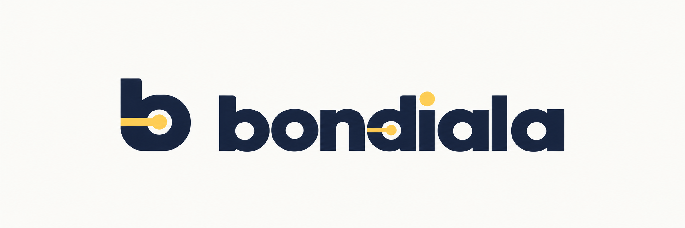
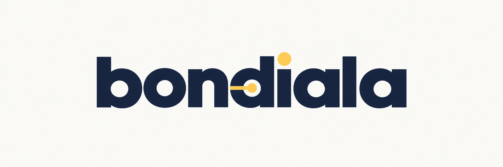
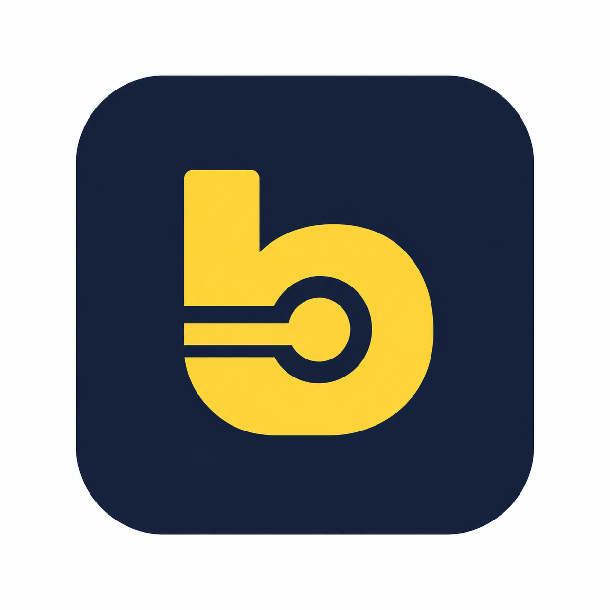

<p align="center">
  <picture>
    <source media="(prefers-color-scheme: dark)" srcset="assets/dark/logo_bondiala.png">
    <source media="(prefers-color-scheme: light)" srcset="assets/light/logo_bondiala.png">
    
  </picture>
</p>

<p align="center">
  <strong>Recorré. Completá. Coleccioná.</strong>
</p>

<p align="center">
  Bondiala convierte tus viajes en colectivo por el AMBA en una experiencia de exploración, progreso y colección.
</p>

---

## ¿Qué es Bondiala?

**Bondiala** es una app para registrar las líneas y recorridos de colectivo que vas haciendo por el AMBA.

No busca decirte cómo llegar de un lugar a otro. La idea es distinta: llevar un registro de todo lo que ya recorriste, descubrir lo que todavía te falta y convertir cada viaje en parte de una colección personal.

> **¿Cuánto del AMBA ya bondiaste?**

---

## ¿Cómo funciona?

Cada vez que viajás, registrás:

1. la **línea**;
2. el **ramal**;
3. el **sentido**;
4. la **parada donde subiste**;
5. la **parada donde bajaste**.

Bondiala reconoce el recorrido entre esos dos puntos y suma automáticamente las paradas que atravesaste.

```text
Subiste en B
      ↓
A ── B ── C ── D ── E ── F
                   ↑
                Bajaste

Bondiala registra:
B · C · D · E
```

No hace falta completar un ramal entero de una sola vez. Podés recorrerlo en muchos viajes distintos y avanzar de a poco.

---

## Tu progreso

El progreso se construye a partir de las paradas que transitaste dentro de cada línea.

```text
Línea
└── Ramal
    ├── Ida
    │   └── Paradas
    └── Vuelta
        └── Paradas
```

A medida que bondiás podés completar:

- paradas;
- sentidos;
- ramales;
- líneas completas.

Si dos ramales de una misma línea comparten una parada, alcanza con haberla transitado una vez dentro de esa línea.

---

## Una colección del AMBA

Bondiala está pensada para que explorar la red de colectivos se sienta como construir una colección.

Podés ver:

- qué líneas ya recorriste;
- cuánto completaste de cada una;
- qué ramales te faltan;
- qué paradas ya transitaste;
- qué zonas del AMBA fuiste descubriendo;
- cuáles son tus próximos objetivos.

El mapa permite visualizar recorridos, progreso y paradas de una manera más directa.

---

## Puntos, niveles y logros

Cada avance suma progreso.

La idea inicial contempla puntos por:

```text
+1   parada nueva dentro de una línea
+5   sentido completado
+15  ramal completado
+50  línea completada
```

Los puntos alimentan tu nivel y permiten comparar tu avance con el de otros usuarios.

También habrá logros por hitos especiales, por ejemplo:

- primera línea recorrida;
- primer ramal completo;
- determinada cantidad de paradas;
- varias líneas completas;
- explorar distintos barrios o comunas.

---

## Rankings

Bondiala contempla distintas formas de comparar el progreso:

- **Global** — progreso acumulado;
- **Semanal** — actividad de la semana;
- **Amigos** — comparación dentro de tu círculo.

La idea es que el ranking acompañe la exploración, sin convertirse en el único objetivo de la experiencia.

---

## Tu perfil

Tu perfil resume tu recorrido por la red.

Ejemplo:

```text
Nivel 23 · Inspector

4.821 pts

3.940 paradas transitadas
74 líneas recorridas
38 ramales completos
12 líneas completas

Ranking global   #38
Ranking semanal  #4
Ranking amigos   #2
```

---

## Bondiar

El nombre nace de convertir el uso del bondi en una acción.

Algunas expresiones que forman parte del lenguaje de Bondiala:

```text
Bondiá una línea nueva.
¿Ya la bondiaste?
Seguir bondiando.
Te faltan 8 paradas.
Este ramal ya lo bondiaste.
```

La idea es construir una experiencia cercana, urbana y bien argentina.

---

## Identidad visual

Bondiala combina una identidad propia con los colores reales de cada línea de colectivo.

Los colores de las líneas tienen protagonismo dentro de la experiencia, mientras que la marca utiliza una paleta más sobria para acompañarlos.

### Light mode

| Uso | Color |
| --- | --- |
| Background | `#FAFAF7` |
| Surface | `#FFFFFF` |
| Surface alt | `#F1F3F5` |
| Text primary | `#1D2433` |
| Text secondary | `#667085` |
| Border | `#D9DEE7` |
| Brand primary | `#17213A` |
| Brand accent | `#FFD447` |
| Interactive | `#26A7E8` |

### Dark mode

| Uso | Color |
| --- | --- |
| Background | `#0E1320` |
| Surface | `#17213A` |
| Surface alt | `#202A44` |
| Text primary | `#F7F8FA` |
| Text secondary | `#AAB2C0` |
| Border | `#303B55` |
| Brand primary | `#FFD447` |
| Brand accent | `#FFD447` |
| Interactive | `#39B5F4` |

Bondiala está pensada desde el inicio para funcionar en:

```text
Light · Dark · System
```

---

## Marca

<p align="center">
  <picture>
    <source media="(prefers-color-scheme: dark)" srcset="assets/dark/wordmark_bondiala.png">
    <source media="(prefers-color-scheme: light)" srcset="assets/light/wordmark_bondiala.png">
    
  </picture>
</p>

<p align="center">
  <picture>
    <source media="(prefers-color-scheme: dark)" srcset="assets/dark/icono_bondiala.png">
    <source media="(prefers-color-scheme: light)" srcset="assets/light/icono_bondiala.png">
    
  </picture>
</p>

Los recursos visuales del proyecto se organizan en:

```text
assets/
├── light/
│   ├── icono_bondiala.ico
│   ├── icono_bondiala.png
│   ├── logo_bondiala.png
│   └── wordmark_bondiala.png
└── dark/
    ├── icono_bondiala.ico
    ├── icono_bondiala.png
    ├── logo_bondiala.png
    └── wordmark_bondiala.png
```

GitHub seleccionará automáticamente la variante clara u oscura del logo, wordmark e icono según el tema del usuario.

---

## ¿Qué se podrá hacer?

La primera experiencia de Bondiala está pensada alrededor de estas acciones:

- crear tu cuenta y perfil;
- explorar líneas y ramales;
- consultar recorridos en el mapa;
- registrar viajes;
- completar paradas, sentidos, ramales y líneas;
- sumar puntos y subir de nivel;
- desbloquear logros;
- seguir tu progreso;
- comparar rankings;
- ver el progreso de amigos;
- usar la experiencia cómodamente desde el celular;
- elegir entre modo claro, oscuro o automático.

---

## Estado

Bondiala cuenta con una implementación MVP para ejecutar localmente: registro de viajes, colección y progreso, puntos, niveles, logros, rankings, perfiles, amigos y mapas. Su catálogo nace del CSV de recorridos del repositorio. Incluye trazados reales de un subconjunto y paradas ilustrativas para explorar la experiencia mientras se completan los datos geográficos.

Para levantarla, consultá [Desarrollo local](docs/desarrollo.md). La documentación de [API](docs/api.md), [Importaciones](docs/importaciones.md) y [Despliegue](docs/deploy.md) detalla la operación y las fuentes de datos. Las [decisiones](docs/decisions.md) y [dependencias externas pendientes](docs/pending.md) explican las limitaciones del catálogo inicial.

Dominio previsto:

```text
bondiala.com.ar
```

La documentación detallada del producto, diseño y decisiones internas se mantiene separada del README para que este archivo siga siendo una presentación simple del proyecto.

---

<p align="center">
  <strong>Bondiala</strong><br>
  El AMBA, línea por línea.
</p>
